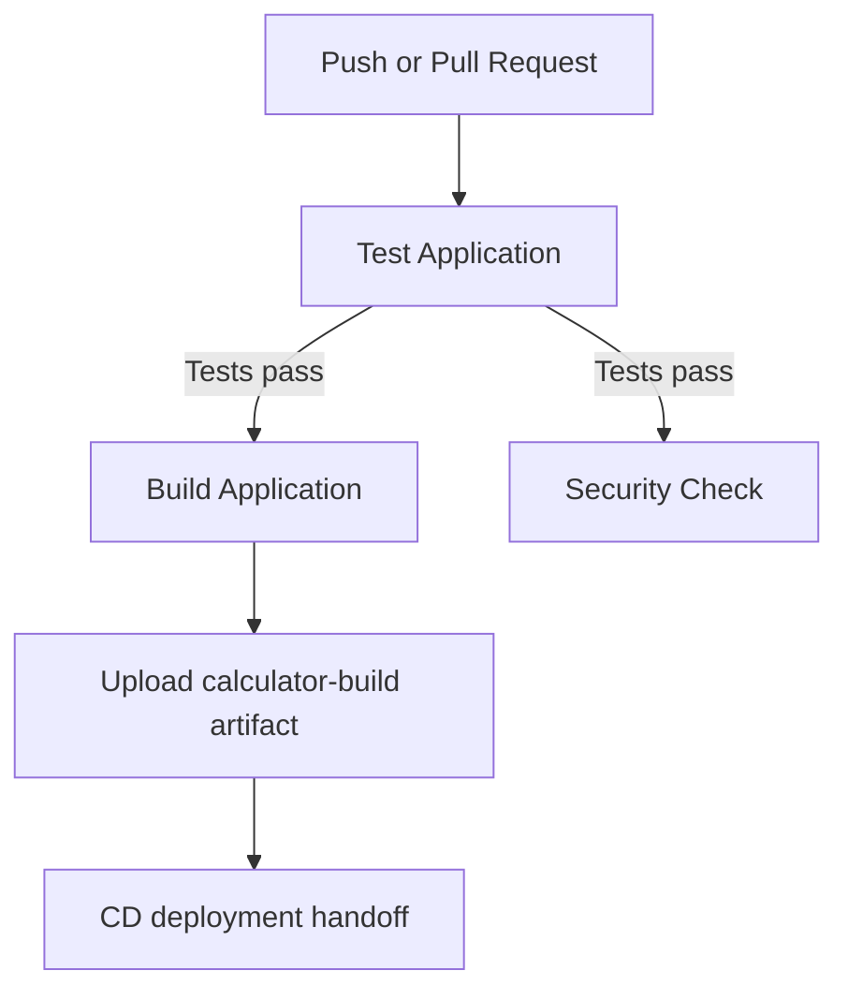
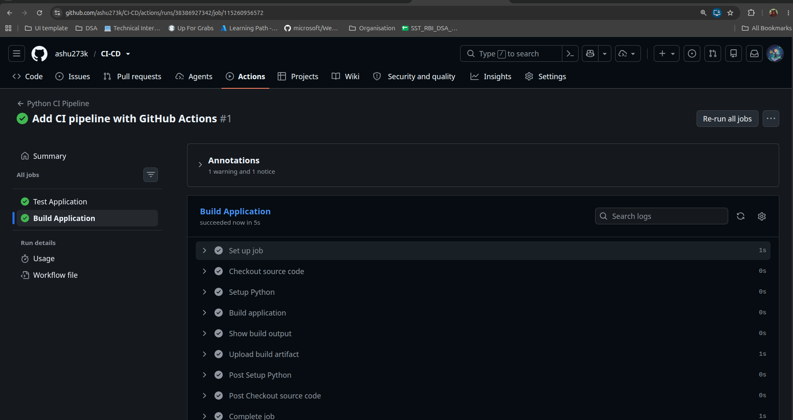

# Session 16: CI/CD with GitHub Actions

## Demo Project

This project demonstrates a Python calculator application automated with GitHub Actions. Every change pushed to the `main` branch, and every pull request targeting `main`, is validated by an automated CI pipeline.

## CI and CD

- **Continuous Integration (CI):** Automatically checks the application by installing its dependencies, running tests, performing a basic security check, and building the application.
- **Continuous Delivery (CD):** The successful build is packaged as a GitHub Actions artifact named `calculator-build`. This artifact is the handoff point for deployment to a target such as Docker, Kubernetes, AWS, or Azure.

The current demonstration focuses on the CI and build-artifact stages. A deployment job can consume `calculator-build` as the next CD stage.

## Project Structure

```text
10-final-cicd-pipeline/
├── .github/
│   └── workflows/
│       └── ci.yml
├── app/
│   └── calculator.py
├── tests/
│   └── test_calculator.py
├── build.sh
├── requirements.txt
└── README.md
```

### Application

`app/calculator.py` provides addition, subtraction, multiplication, and division. Division by zero is handled with a `ValueError`.

### Tests

The test suite uses `pytest` and verifies all calculator operations, including the division-by-zero error case.

### Build Output

The build script creates the following files:

```text
build/
├── calculator.py
└── build-info.txt
```

## GitHub Actions Workflow

The workflow is stored at `.github/workflows/ci.yml` and can be started by:

- A push to `main`
- A pull request targeting `main`
- A manual `workflow_dispatch` trigger

It uses a GitHub-hosted `ubuntu-latest` runner and Python 3.12.

### Jobs and Steps



1. **Test Application**
	- Checks out the source code.
	- Sets up Python 3.12.
	- Installs dependencies from `requirements.txt`.
	- Runs `pytest -v`.

2. **Build Application**
	- Runs after the test job using `needs: test`.
	- Executes `build.sh`.
	- Displays `build/build-info.txt`.
	- Uploads the `build/` directory as the `calculator-build` artifact.

3. **Security Check**
	- Runs after the test job.
	- Checks for common sensitive files such as `.env`, `*.pem`, and `*.key`.

If the test job fails, the build job does not run. This prevents a failed application from being packaged for delivery.

## Secrets and Security

GitHub Actions secrets should be used for credentials required by a real deployment, such as a container registry token or cloud provider credentials. Secrets must be configured in the repository or environment settings and referenced through `${{ secrets.SECRET_NAME }}`. They should never be committed to the repository.

The security job in this demo is an introductory check and is not a replacement for a complete security scanner.

## Run the Project Locally

From the `10-final-cicd-pipeline` directory:

```bash
python3 -m pip install -r requirements.txt
python3 app/calculator.py
pytest -v
chmod +x build.sh
./build.sh
```

## Pipeline Execution

The following screenshot shows a successful GitHub Actions execution. The test and build jobs completed successfully, and the build artifact was uploaded.



## Deliverables

- Application source code: `app/calculator.py`
- Automated tests: `tests/test_calculator.py`
- GitHub Actions workflow: `.github/workflows/ci.yml`
- CI pipeline: test, security-check, and build jobs
- Build artifact: `calculator-build`
- Runner: `ubuntu-latest`
- Dependency specification: `requirements.txt`
- Build script: `build.sh`
- Successful pipeline screenshot: `CI-CD.png`
- Project documentation: `README.md`

## Learning Outcome

This demo shows how a GitHub push can trigger a workflow, execute jobs on a runner, run repeatable steps, stop a build when tests fail, and publish a successful build as an artifact ready for the CD stage.
