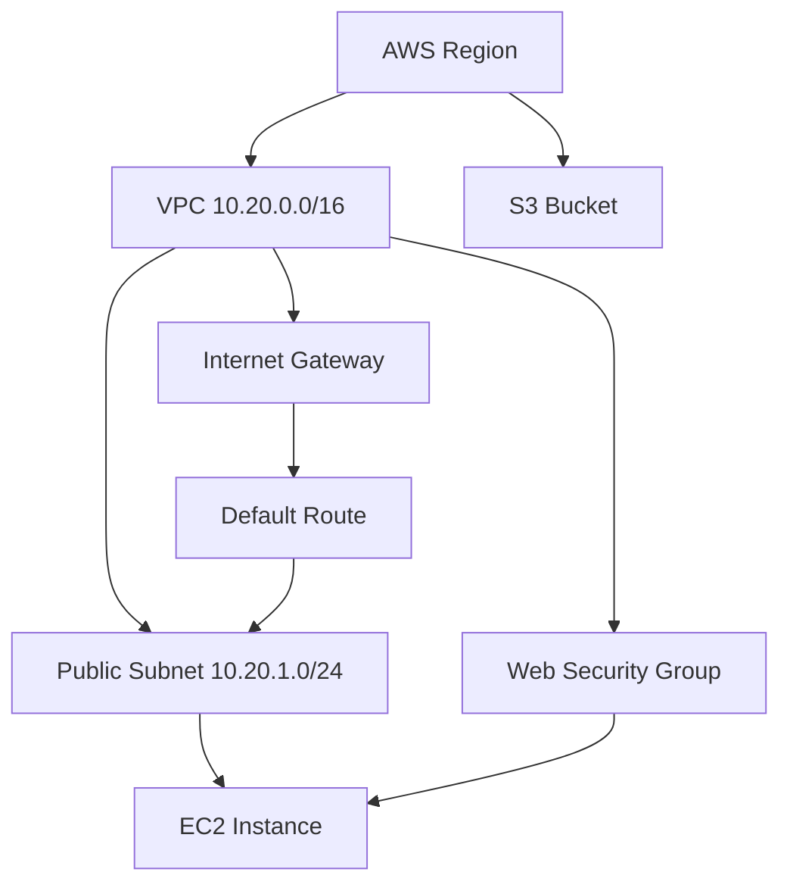

# Session 19 Homework: Cloud and Terraform in Action

## End-to-End AWS Infrastructure Project

Build and document an AWS infrastructure stack with Terraform. The project must show how providers, variables, resources, outputs, dependencies, and Terraform state work together to create and remove cloud infrastructure safely.

## Required Architecture

```text
						 Internet
							 |
							 v
					Internet Gateway
							 |
					Public Route Table
							 |
				 +-----------+-----------+
				 |      Public Subnet   |
				 |      10.20.1.0/24    |
				 |             |         |
				 |        EC2 Instance  |
				 |             |         |
				 |      Web Security    |
				 |         Group        |
				 +-----------+-----------+
							 |
					   VPC 10.20.0.0/16

					S3 Bucket
					(separate AWS resource)
```

The core dependency chain should be:

```text
VPC -> Subnet -> Route Table Association -> EC2
VPC -> Internet Gateway -> Route -> Public Subnet
VPC -> Security Group -> EC2
S3 Bucket
```

The route table and internet gateway are included because an EC2 instance in a public subnet needs a route to the internet gateway. A public IP and an open security group alone do not make a host reachable.

## Required Resources

Create these resources with Terraform:

- AWS provider and region configuration.
- VPC with a configurable CIDR block.
- Public subnet with a configurable CIDR block and availability zone.
- Internet gateway attached to the VPC.
- Public route table with a default route to the internet gateway.
- Route table association for the public subnet.
- Security group attached to the VPC.
- EC2 instance in the public subnet.
- S3 bucket with a unique name.

The EC2 instance should use a configurable AMI, instance type, and SSH key pair. Prefer an Amazon Linux or Ubuntu AMI selected for the configured region rather than hard-coding an AMI from a different region.

## Project Structure

```text
cloud-terraform-demo/
├── README.md
├── versions.tf                 # Terraform and provider versions
├── provider.tf                 # AWS provider configuration
├── variables.tf                # Input variable declarations
├── terraform.tfvars.example    # Safe example values
├── terraform.tfvars            # Local values; do not commit secrets
├── main.tf                     # VPC, networking, EC2, and S3 resources
├── outputs.tf                  # IDs, addresses, and bucket outputs
├── .gitignore                  # State, plans, and local secrets
└── diagrams/
	└── architecture.md        # Architecture diagram
```

Splitting resources into additional files such as `network.tf`, `compute.tf`, and `storage.tf` is acceptable if the README explains the layout.

## Variables

At minimum, define variables for:

- `aws_region`
- `project_name`
- `vpc_cidr`
- `public_subnet_cidr`
- `availability_zone`
- `instance_type`
- `ami_id`
- `key_name`
- `ssh_ingress_cidr`

Use a narrow CIDR for SSH, such as the learner's current public IP with `/32`. Do not use `0.0.0.0/0` for SSH except in a short-lived, explicitly documented test. HTTP access may be opened to the internet only when the instance actually runs a web server and the risk is understood.

Provide `terraform.tfvars.example` without credentials or private keys:

```hcl
aws_region          = "ap-south-1"
project_name        = "session19-cloud-demo"
vpc_cidr            = "10.20.0.0/16"
public_subnet_cidr  = "10.20.1.0/24"
availability_zone   = "ap-south-1a"
instance_type       = "t3.micro"
ami_id              = "ami-REPLACE_FOR_YOUR_REGION"
key_name            = "REPLACE_WITH_EXISTING_KEY_PAIR"
ssh_ingress_cidr    = "REPLACE_WITH_YOUR_IP/32"
```

Copy and customize it before running Terraform:

```bash
cp terraform.tfvars.example terraform.tfvars
```

Never commit AWS access keys, private SSH keys, `terraform.tfstate`, or a plan file containing sensitive values.

## Outputs

Expose enough information to verify the deployment:

- VPC ID and CIDR.
- Public subnet ID.
- Route table ID.
- Security group ID.
- EC2 instance ID and public IP or public DNS name.
- S3 bucket name and ARN.
- AWS region.

Mark sensitive outputs as `sensitive = true` when they contain confidential values. Resource IDs are normally safe to display, but review output before sharing screenshots.

## Prerequisites

Install:

- Terraform CLI.
- AWS CLI.
- An AWS account with permission to manage the resources in this project.
- An existing EC2 key pair in the selected AWS region.

Configure credentials through the standard AWS credential chain, for example:

```bash
aws configure
aws sts get-caller-identity
```

Confirm the account and region before applying. This project creates billable cloud resources. A `t3.micro` may qualify for a free tier depending on the account, region, and current AWS terms, but do not assume that it is free.

## Terraform Workflow

Run these commands from the Terraform project directory.

### 1. Initialize

```bash
terraform init
```

This downloads the AWS provider and prepares the working directory. A successful run ends with:

```text
Terraform has been successfully initialized!
```

### 2. Format

```bash
terraform fmt -recursive
```

Check formatting in CI without changing files:

```bash
terraform fmt -check -recursive
```

### 3. Validate

```bash
terraform validate
```

Expected result:

```text
Success! The configuration is valid.
```

Validation checks syntax and configuration references. It does not create AWS resources.

### 4. Plan

```bash
terraform plan
```

Review the resource names, region, CIDR blocks, security group rules, AMI, key pair, and S3 bucket name. For a new deployment, the summary should show resources to add and no unexpected destroys.

For a controlled apply, save the reviewed plan:

```bash
terraform plan -out=tfplan
```

The saved plan must not be committed because it can contain sensitive values.

### 5. Apply

Apply the reviewed plan:

```bash
terraform apply tfplan
```

Alternatively, use `terraform apply` and review the displayed plan before entering `yes`.

Terraform should create the network before the instance because the EC2 resource references the subnet and security group. The S3 bucket is independent of the VPC dependency chain.

### 6. Inspect State and Outputs

List resources tracked in state:

```bash
terraform state list
```

Inspect the complete state-derived configuration:

```bash
terraform show
```

Display output values:

```bash
terraform output
```

Read a single value for a command:

```bash
terraform output -raw ec2_public_ip
```

The exact output names may differ if the project uses a different naming convention, but the README must document them.

### 7. Verify in AWS

Verify the VPC and subnet:

```bash
aws ec2 describe-vpcs --filters "Name=tag:Name,Values=session19-cloud-demo-vpc"
aws ec2 describe-subnets --filters "Name=tag:Name,Values=session19-cloud-demo-public-subnet"
```

Verify the instance:

```bash
aws ec2 describe-instances \
  --filters "Name=tag:Project,Values=session19-cloud-demo" \
  --query 'Reservations[].Instances[].{Id:InstanceId,State:State.Name,PublicIp:PublicIpAddress}'
```

Verify the bucket:

```bash
aws s3api head-bucket --bucket "$(terraform output -raw s3_bucket_name)"
```

Do not test SSH or HTTP unless the instance is configured for that purpose and the security group is restricted appropriately.

### 8. Destroy

First preview deletion:

```bash
terraform plan -destroy
```

Then remove all resources:

```bash
terraform destroy
```

Enter `yes` only after confirming the target AWS account. Verify that the instance, security group, subnet, route table, internet gateway, VPC, and bucket have been removed. An S3 bucket containing objects may require emptying before Terraform can destroy it.

## State Requirements

Terraform state records the relationship between configuration and real AWS resources. For this exercise, local state is acceptable, but the following files must be ignored:

```gitignore
.terraform/
*.tfstate
*.tfstate.*
*.tfplan
terraform.tfvars
crash.log
```

For team or production use, configure an encrypted remote backend with locking, such as S3 plus a locking mechanism supported by the selected Terraform version. Do not manually edit or delete state to solve an error.

## Architecture Diagram

Include an architecture diagram in `diagrams/architecture.md` or the project README. It must show:

- AWS region.
- VPC CIDR.
- Public subnet CIDR.
- Internet gateway and route table.
- Security group and EC2 instance.
- S3 bucket as a separate storage resource.
- The important Terraform dependency relationships.

Mermaid is acceptable:



## Required Evidence

Include screenshots or terminal output for:

1. `aws sts get-caller-identity` with sensitive values redacted.
2. Successful `terraform init`, `fmt`, and `validate`.
3. A reviewed `terraform plan`.
4. Successful `terraform apply`.
5. `terraform state list`, `terraform show`, and `terraform output`.
6. VPC, subnet, security group, EC2, and S3 resources in AWS.
7. Successful `terraform destroy`.
8. The architecture diagram.

Store evidence in an `evidence/` or `screenshots/` directory and redact account secrets, credentials, private IP details where appropriate, and private key material.

## Acceptance Checklist

- [ ] Terraform provider is configured.
- [ ] Variables and example values are documented.
- [ ] VPC and subnet are created.
- [ ] Internet gateway, route table, and route association are created.
- [ ] Security group follows least-privilege rules.
- [ ] EC2 is connected to the subnet and security group through Terraform references.
- [ ] S3 bucket is created with a unique name.
- [ ] Useful outputs are defined.
- [ ] `terraform init` succeeds.
- [ ] `terraform fmt` and `terraform validate` succeed.
- [ ] `terraform plan` is reviewed.
- [ ] `terraform apply` succeeds.
- [ ] Terraform state and outputs are inspected.
- [ ] AWS resources are verified.
- [ ] `terraform destroy` succeeds.
- [ ] Architecture diagram, screenshots, commands, and README are included.
